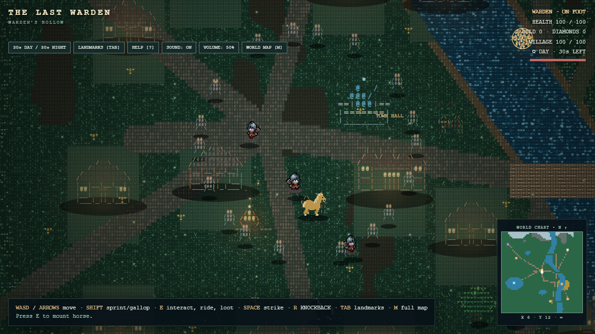
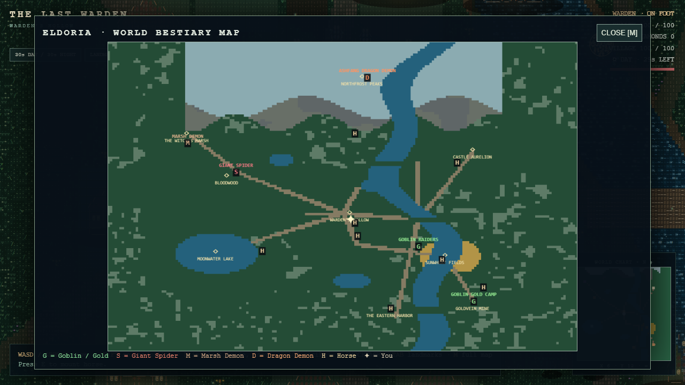
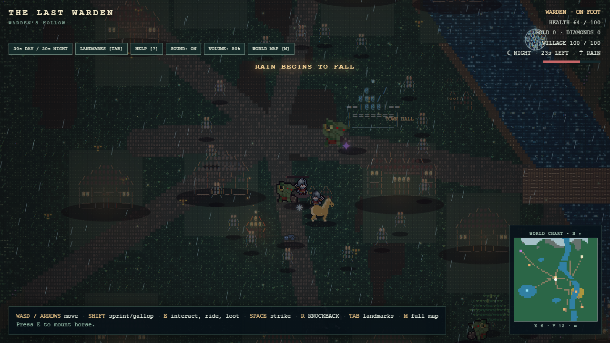

# The Last Warden

An explorable ASCII fantasy world with horses, animated water and grass, changing weather, day and night, and hostile creatures.

## Screenshots

### Warden's Hollow

### World map

### Rainy night battle

## Gameplay video

[Watch or download the gameplay video (MP4)](The-Last-Warden-Integrated/media/gameplay-demo.mp4). The video was supplied by the project owner; the screenshots show the current build.

## Run locally

From `The-Last-Warden-Integrated`, run `node server.js`, then open `http://127.0.0.1:4173/`.

See the [full game README](The-Last-Warden-Integrated/README.md) for controls, artwork, and audio details.
