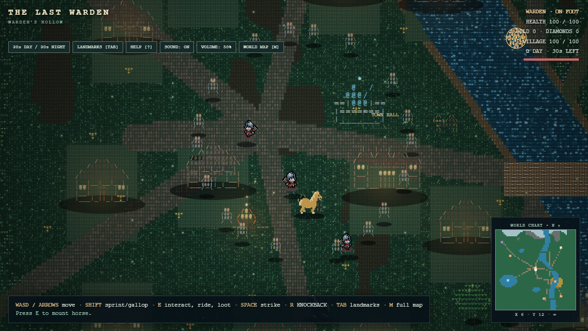
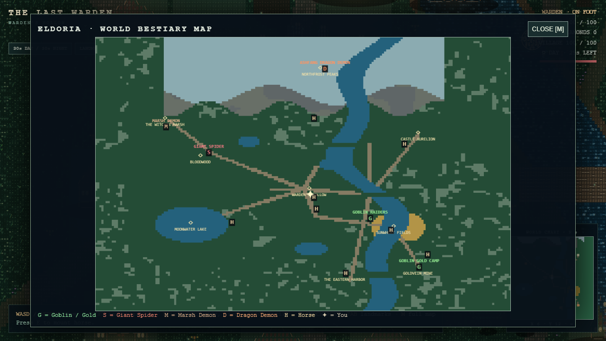
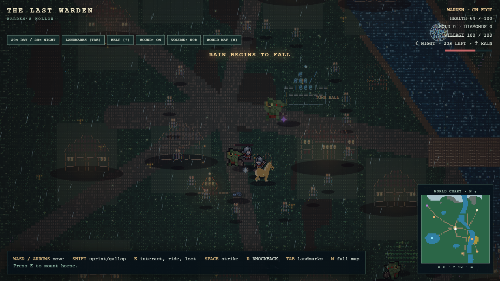

# The Last Warden — integrated ASCII world

The supplied HTML world provides the map and coordinate system. Terrain is rendered with smaller, denser ASCII cells while roads, river, lake, village, castle, lairs, landmarks, and minimaps retain their original positions. Water, reeds, trees, fires, and boats animate independently of the cached terrain. Grass blades sway with passing wind gusts. Rain falls for about 20 seconds in each 90-second weather cycle, during either day or night. Rain is visual and does not change combat or movement.

## Screenshots and video

[Watch or download the gameplay video (MP4)](media/gameplay-demo.mp4). The video was supplied by the project owner; the screenshots above show this updated build.

## Run

Requires Node.js. In this folder, run `node server.js`, then open `http://127.0.0.1:4173/`. To use another port in PowerShell, set `$env:PORT=4174` before starting the server.

## Play

- WASD or arrow keys: move. Hold Shift to sprint or gallop.
- E: interact, mount or dismount a horse, and open chests.
- Space: directional sword strike. R: radial knockback.
- Tab: landmark labels. M: world map. `?`: help.
- SOUND toggles music and effects. VOLUME cycles 25%, 50%, 75%, and 100%.

Day and night each last 30 seconds. Each night, goblins, archers, spiders, and a marsh demon surround and hunt the Warden. Archers fire dodgeable arrows; spiders shoot webs; the marsh demon casts magic. Enemies can also attack in melee. Soldiers defend villagers, and the village health falls when villagers are hit. Defeat opens a restart screen. The dragon demon stays in its northern lair.

## Art and audio

The Soldier sheet animates the Warden and village soldiers. The Hobgoblin pack supplies goblins, the enlarged dragon demon, and the marsh demon. The Spider Sprite Sheet animates spiders. The Horse Pack supplies eight horse variants across the map. The ship sheet supplies boats. The supplied arrow sprite is used for goblin projectiles.

No witch character sprite was supplied. The Witch’s Cottage remains a landmark; a separate witch enemy is pending art. The marsh demon uses Hobgoblin art, as requested.

The three user-supplied music tracks play locally. New combat, hoofstep, and phase sound effects are generated in the browser with Web Audio; no copyrighted game effects were copied.

Horse Pack art: loota9, CC BY 4.0 ([loota9](http://linktr.ee/loota9)). The music files were supplied by the user for this local build. No network requests or third-party libraries are required.
